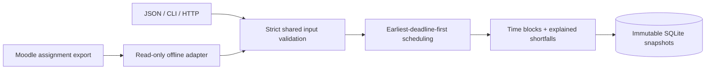

# Campus Workload Planner

Turn assignment deadlines, remaining effort, and available study windows into a concrete plan. When the work cannot fit, see the exact number of unscheduled minutes and the affected deadlines.

Python 3.11+, a deterministic scheduling core, SQLite snapshots, a CLI, and an optional FastAPI adapter. No AI calls, campus account, or external service is required. The offline Moodle adapter is designed around the `list_assignments` response in the existing Lehigh MCP project; live integration is future work.

## Try the example

```bash
python -m campus_planner.cli plan examples/week.json
```

The example has 270 minutes of remaining work and 240 available minutes. It schedules the SQL lab before noon, finds only 90 of the 120 minutes needed for API tests before their deadline, and schedules the 90-minute design note the next morning. **30 minutes remain unscheduled.** Adding free time after the API-test deadline does not solve that shortfall.

The `now` timestamp is explicit, so the example and its result stay reproducible even when run on a different day. Edit it and the windows for a real plan.

```bash
python -m campus_planner.cli plan examples/week.json --db plans.sqlite3
python -m campus_planner.cli history --db plans.sqlite3
python -m campus_planner.cli show PLAN_ID --db plans.sqlite3
```

`--require-feasible` makes `plan` exit with code 3 when work does not fit. Invalid input exits 2; a missing saved plan exits 4.

## HTTP API

```bash
python -m venv .venv
. .venv/bin/activate
pip install -c requirements-tested.txt -e '.[api,test]'
uvicorn campus_planner.api:app --host 127.0.0.1 --port 8000
```

Open `http://127.0.0.1:8000/docs` for the API explorer. To submit the same example:

```bash
curl -s http://127.0.0.1:8000/v1/plans \
  -H 'Content-Type: application/json' \
  --data-binary @examples/week.json
```

| Endpoint | Behavior |
| --- | --- |
| `POST /v1/plans` | Validate, schedule, persist; identical input and algorithm return the same ID |
| `GET /v1/plans/{id}` | Retrieve an immutable result; 404 for an unknown ID |
| `GET /v1/plans?limit=20` | Bounded history of IDs and creation times |
| `GET /health` | Verify local storage is reachable |

`CAMPUS_PLAN_DB` selects the database path. This is a single-user localhost API without authentication. Do not expose personal plans publicly; a hosted version needs user isolation, authentication, quotas, and backups first.

## How it works



1. Require explicit timezone offsets and whole-minute timestamps. Convert to UTC.
2. Merge overlapping availability, and discard time before `now`.
3. Order remaining tasks by deadline, with task ID as a deterministic tie-breaker.
4. Fill free intervals up to each deadline, splitting work across gaps if needed.
5. Report every task's scheduled and unscheduled minutes. Completed work consumes no capacity.

This policy assumes all tasks are available now and work can be interrupted at minute boundaries. It checks feasibility under those assumptions; it does not maximize grades, number of completed assignments, or personal preferences. There are no prerequisites, release dates, minimum focus blocks, or travel times. Complexity is `O(T log T + W log W + T × W)` with at most 500 tasks and 500 windows.

## Lehigh MCP boundary

```bash
python -m campus_planner.cli import-moodle examples/moodle-assignments.json \
  --estimates examples/estimates.json
```

The importer retains only assignment IDs, names, deadlines, and effort you explicitly estimate. It reports missing estimates and deadlines rather than inventing them. Assignment instance IDs are used, not course-module IDs. Raw warnings, grades, submission text, and tokens are not copied into a plan.

See [the integration plan](docs/LEHIGH_MCP.md) for the next step after the hackathon. No live CourseSite calls or calendar writes are implemented.

## Test

```bash
pip install -c requirements-tested.txt -e '.[test]'
python -m unittest discover -s tests -v
```

Tests cover overlap normalization, deadline boundaries, past windows, partial completion, timezone transitions, stable storage IDs, retries, malformed imports, CLI exit codes, and HTTP persistence. A seeded randomized test checks non-overlap, work conservation, capacity bounds, and feasibility against an independent deadline-prefix calculation across 150 schedules.

## Development note

Built as an AI-assisted portfolio project with explicit tests and design tradeoffs. The learning goal is to understand and extend the scheduler, persistence boundary, and integration contract, rather than treating generated code as proof of proficiency.
